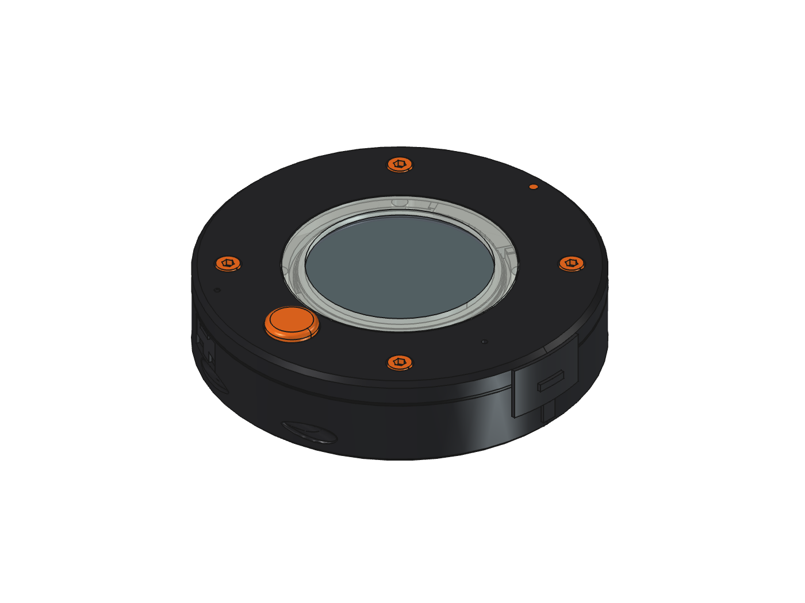
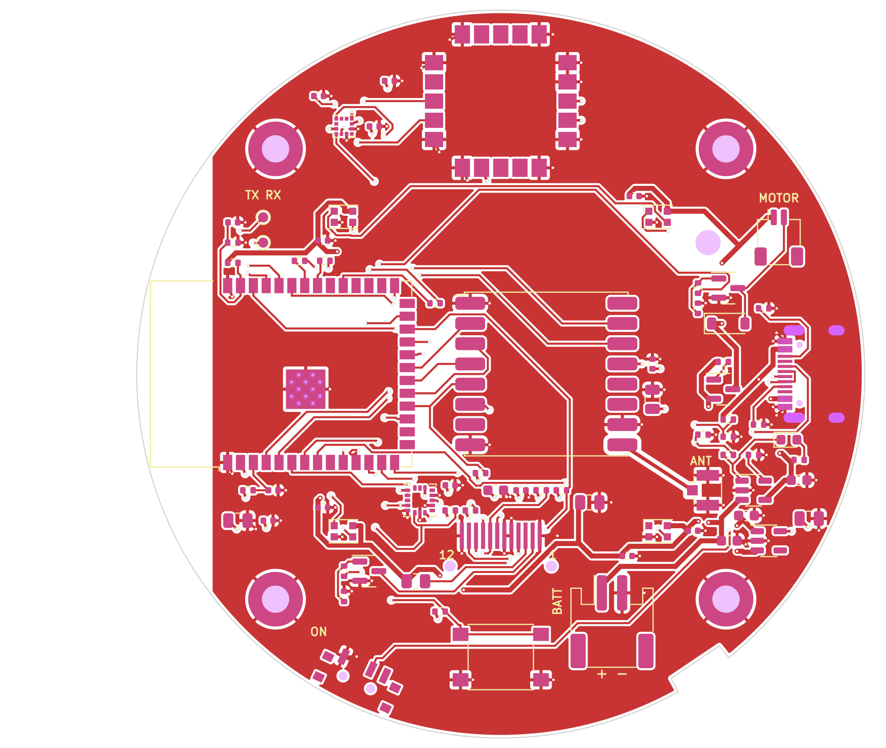
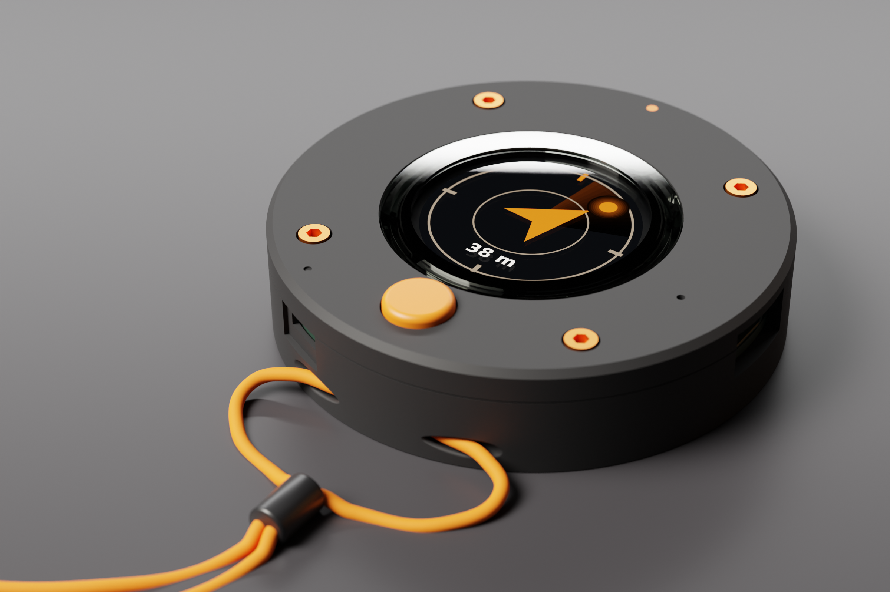
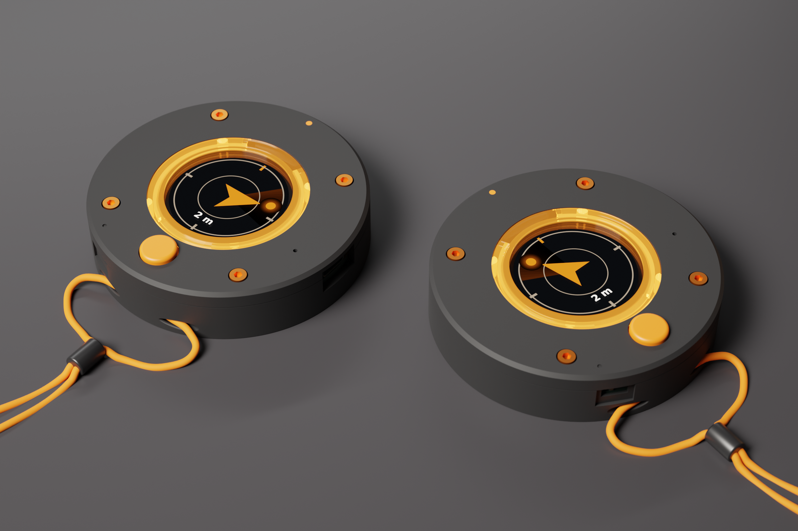

# Finder Puck

A pocket puck so two people can find each other in a loud, crowded place without phones. Each puck has GPS, a
compass and a LoRa radio (915 MHz, no cell service needed); the two swap positions and each shows a **radar-style
arrow and the distance** to the other on a round screen. A vibration motor pulses faster as you get closer, four
LEDs on the face strobe a "beacon me" pattern for the last few metres, and there is exactly one button.



76.4 mm across, 18.3 mm thick. The body is a CNC-machined 6061 aluminium shell, black anodised, under a matte black
plastic face; between 12 and 3 o'clock the side wall is a black plastic antenna window, because aluminium would
block the radios (see [Aluminium shell and the radios](#aluminium-shell-and-the-radios)). Orange anodised
socket-cap bolts on the face pass through the PCB, a 10 mm orange button at 6 o'clock, a clear bezel around the
crystal that the four beacon LEDs light from below, and an orange index dot at 12 o'clock over the GPS patch, which
looks through a 0.9 mm skin. The back is plain anodised aluminium with the Open Source Hardware logo engraved as a
V-groove line through to bare metal; the cord goes in at the side at 6 o'clock and out of the back. The case is designed to IP55 (dust protected, water
jets from any direction) with the USB-C door slid shut and the switch plug pushed home; see [Sealing (IP55)](#sealing-ip55).
[Build guide (PDF)](docs/finder_puck_build_guide.pdf).



## Files

| Path | Contents |
|---|---|
| `finder_puck.kicad_pro` | KiCad 7 project (open this) |
| `finder_puck.kicad_sch` | Schematic ([PDF](docs/schematic.pdf)) |
| `finder_puck.kicad_pcb` | Routed 72 mm round 4-layer board (one edge notch for the battery lead) |
| `lib/finder_puck.kicad_sym`, `lib/finder_puck.pretty` | Project symbols and the 0.7 mm FPC solder footprint |
| `lib/3dmodels/` | 3D models (see "3D models" below) |
| `fab/finder_puck_gerbers.zip` | Gerbers and drill files |
| `fab/finder_puck_bom.csv`, `fab/finder_puck_cpl.csv` | Assembly BOM and placement (JLCPCB column names) |
| `mech/finder_puck.step`, `mech/finder_puck_features.json` | Populated board in 3D, and everything the case needs from it |
| `case/finder_puck_case.FCStd` | FreeCAD assembly: board, panel, crystal, battery, motor, antenna, bolts, shell, window, plate, ring, bezel, cap |
| `case/finder_puck_case.step` | All made parts in STEP |
| `case/finder_puck_{shell,window}_shop.step`, `case/finder_puck_shell_drawing.pdf` | For the shop: the shell and the window each on its own, origin on the axis at the back face, and the shell's A3 drawing (threads, tolerances, finish, setups) |
| `case/finder_puck_{window,plate,ring,bezel,cap}.stl` | Print files (`finder_puck_shell.stl` too, for previews) |
| `case/finder_puck_logo_vgroove.svg`, `case/oshw_logo.svg` | 1:1 drawing of the back logo's V-groove path for the machinist; the logo's source path (Simple Icons, CC0) |
| `case/finder_puck_gaskets.svg`, `case/finder_puck_gaskets.dxf` | 1:1 cutting template for the lid, crystal and door gaskets; the same plus the seam seal and window strip as a DXF for a converter's cutter (a layer per foam thickness) |
| `case/finder_puck_{door,switchplug}.stl` | The sliding USB-C door and the TPU switch plug |
| `docs/finder_puck_build_guide.pdf` | Step-by-step assembly guide (IKEA style) |
| `manual/` | The guide's content, renderer and layout scripts |
| `docs/finder_puck_render{,_pair,_back}.png` | Blender studio renders: the puck searching, the pair that found each other (beacons lit), the back |
| `case/export_meshes.py`, `case/render_blender.py` | Mesh export from the FreeCAD assembly, and the Blender scene behind the renders (see "Renders" below) |
| `tools/`, `case/build_case.py`, `case/render_case.py`, `regen.sh` | Generators for all of the above |
| `firmware/` | ESP32-S3 firmware (PlatformIO); see [firmware/README.md](firmware/README.md) |

## Parts

| Ref | Part | Job |
|---|---|---|
| U1 | ESP32-S3-WROOM-1-N8 | Brain; flashed over USB-C (native USB) |
| U2 | RFM95W-915S2 (SX1276) + U.FL (J4) | LoRa link between the two pucks; the feed is a single pre-routed top-layer track |
| U3 | u-blox SAM-M10Q | GPS with built-in patch antenna, under the sky window |
| U4, U5 | LIS3DH + LIS2MDL | Tilt-compensated compass |
| J3 | 1.28″ 240×240 GC9A01 round IPS panel | The radar screen (bare panel, 12-pin 0.7 mm FPC soldered to the board) |
| Q2, R13–R15 | Backlight driver | Two parallel white LEDs from the battery rail, PWM dimmed |
| LED1–LED4 | WS2812B-2020 | Beacon, up four light pipes into the translucent bezel |
| J5, Q1, D1 | Coin vibration motor and driver | Haptic pulse |
| U6, U7 | MCP73831 charger, AP2112K 3.3 V regulator | 1S LiPo on J2, charged from USB-C |
| SW1 | C&K PTS645 (5 mm stem), under the orange cap | Beacon / pair button |
| SW2, Q3, R22 | C&K PCM12 slide switch, AO3401A | On/off: the switch grounds the P-FET's gate, the FET carries the current |
| H1–H4 | M2.5 plated holes | The four case bolts pass through them |
| H5 | 2.5 mm hole | Motor lead comes up through the board |
| R21, R25, R26 | Dividers | Charger state and USB-present sensing, scaled to 3 V |
| TP1, TP2 | Test pads | UART0 TX/RX, reachable with the plate off |

ESP32 pins: LoRa SPI on IO10–IO14 (NSS, MOSI, SCK, MISO, RST), DIO0/DIO1 on IO4/IO5. GPS UART on IO17 (to GPS)
and IO18 (from GPS). I2C on IO8 (SDA) / IO9 (SCL) for LIS3DH (0x18) and LIS2MDL (0x1E). **Display on its own SPI
bus: SCK IO40, MOSI IO41, CS IO42, D/C IO21, RST IO47, backlight PWM IO48.** LEDs IO38 (through 220 Ω), motor
IO7 (IO39 has a pull-up at reset and would run the motor during boot), button IO0, battery sense IO1 (half of
VSYS), LIS3DH INT1 IO2, charger state IO6 (high only when the cell is full), USB present IO15.

The panel's FPC pinout (1–12): GND, LEDK, LEDA, VDD, GND, GND, D/C, CS, SCL, SDA, RESET, GND. Run the display at
40–80 MHz (never 26.67 or 13.33 MHz: a harmonic lands on GPS L1).

## How it goes together

Z = 0 is the top of the PCB.

- **Shell** (6061-T6, black anodised): machined in three setups, from the top, the back and the side, with no
  undercuts. A 1.8 mm floor, a bay for a 503450-class LiPo (34.5 × 52 × 5.3 mm, on 0.5 mm foam) whose wall is a
  Ø68.8 bore under the board's Ø72.8 one, so the step between them is the 2 mm ledge the board rests on; four
  Ø6.5 bosses with tapped M2.5 holes (5 mm of thread, blind) that run into the bay's wall with 1.5 mm inside radii
  (a 3 mm cutter); a pocket for the 10 mm coin motor at 2 o'clock; a slot in the bay wall at 304° for the battery
  lead and the antenna pigtail (floor to ledge, out to the board's bore, 1.5 mm inside radii); and the switch slot (1 mm corner radii) with its finger scallop (2 mm radii) and the
  switch plug's Ø1.6 pin hole, all below the rim, so the seam seal passes over them unbroken. Between 12 and 3
  o'clock (−14° to 81° at the floor) the wall is cut down to the floor for the antenna window, and the cut's two
  ends are 60° flanks, so the window gasket on them is squeezed by the bolts like the rim seal is; the boss at 45°
  stands on its own there, and the one at 315° stays whole outside it. Two Ø2.1 holes in that floor take the window's pegs. The outer edge of the back has a
  1 mm radius. The back is plain apart from the Open Source Hardware logo, 22 mm across, engraved as a line: a 90°
  V-bit follows its outline (a contour, not a pocket) 0.3 mm deep, so the groove is 0.6 mm wide, after anodising so
  it shows bare aluminium (`case/finder_puck_logo_vgroove.svg` is the 1:1 drawing). The lanyard is two Ø3.0 holes drilled square to the
  surface at 6 o'clock, one up from the back (r 35.3, stopping 1 mm above the side hole's axis, so its point stays
  0.7 mm under the boss's top) and one in from the side (Z −6.2), meeting in a boss inside the wall, with 0.4 mm countersinks on both mouths; deburr the inside of the bend.
- **Window** (black, printed): the plastic wall that fills the shell's notch, 0.6 mm clear of the notch floor and
  both flanks (normal to each face: the window gasket's squeeze), flush with the shell's rim at the top. It carries
  the 915 MHz flex antenna on its inside, the USB-C opening up to the parting line, the door's pocket with its
  sealing land and lower groove, and two feet inside the wall that stand on the shell's floor with Ø2 pegs in its
  holes, which locate it and set the gasket's squeeze.
- **Board** sits on the ledge (the 2 mm step between the two bores, cut away in the window); the motor lead comes up through H5 next to J5,
  and the battery lead and the antenna pigtail come up through a 4.5 mm notch in the board edge at 304°. J2 sits
  5.6 mm from the wall so the PH plug fits in front of it.
- **Ring** (black): a short cup standing on the board on a 0.5 mm foam ring. Its 0.85 mm wall (Ø36.3 bore,
  0.35 mm around the panel) is open at 6 o'clock where the panel's chin and the folded FPC pass, and starts
  3.6 mm up over the ESP32 can. The panel drops in from above onto the ledge 4.0 mm above the board. The ring
  is modelled 0.25 mm into the foam, so the bolted stack always preloads it. Over the GPS module (64–116°) the
  wall is a single 0.45 mm perimeter (outer face at r 18.6), 0.6 mm from the module at its widest: the SAM-M10Q
  data sheet (UBX-22013293, table 19) gives 15.4–15.6 mm over the whole height, 5.8–6.8 mm tall, with
  de-paneling tabs of up to 0.3 mm at the PCB corners. u-blox's own STEP draws the patch 0.5 mm narrower than
  the drawing does, so the drawing is what the case is built to.
- **Bezel** (clear resin): a 0.3 mm foam gasket sits on the panel's glass, the Ø37.5 × 1.0 mm flat mineral
  crystal rests on the ring's top, and the bezel sits over both: a skirt around the ring top locates it (0.25 mm
  radial), its seat holds the crystal (0.25 mm radial), its lip (Ø34.8 window, flared to Ø43.4) overlaps the
  glass by 0.2 mm and is the visible dial ring, pressing a 0.3 mm die-cut foam ring (Ø35.2–37.2) onto the
  crystal's edge, and its 0.5 mm flange under the plate skin, which runs all the way round, is what the bolts
  clamp, through a die-cut lid gasket. The flange has a lobe at 6 o'clock that carries the button bore's sleeve
  (down to Z 5.2, with a 0.4 mm lead-in, for the cap's O-ring) and a tab out to the charge LED with a Ø1.2 mm
  light pipe up through the skin to the face (Ø1.6 below the flange, 0.3 mm above the LED). Four Ø3 mm light
  pipes hang from the flange to 0.3 mm above the WS2812s, so the whole lip glows when the beacon runs. Over the
  GPS module (12 o'clock, 64–116°) the ring wall is thinned and nothing of the bezel beyond r 18.7 comes below
  the flange (Z 7.0, 0.2 mm over the tallest module). The ring used to be one part; a panel cannot be fitted past a ledge below it and a lip above it, hence the split. `LIP_PROUD`
  raises the lip's top above the face (default 0, see "Seeing the beacon from the side").
- **Plate** (black): plastic on purpose, since it is the GPS patch's radome. Skin 1.6 mm, face at Z 8.6, Ø8 bosses
  down to the board (they, not the rim, are the datum: the 1.8 mm skirt stops 0.6 mm above the rim of the shell and
  the window, the gap the 1.0 mm foam seal is squeezed into), Ø5.2
  counterbores so the orange M2.5 × 12 socket-cap heads sit 0.2 mm proud on a 0.5 mm nylon washer (Ø3.0 bores,
  Ø2.8 holes in the board), the Ø44 bezel opening (0.3 mm reveal) with a pocket 0.7 mm deep under
  the skin for the bezel's flange and the lid gasket, the skin thinned to 0.9 mm over the GPS module out to the
  wall (`GPS_WINDOW = "open"` in `build_case.py` cuts it open instead), a blind Ø1.8 × 0.6 mm hole in that cover
  at 12 o'clock for a glued orange 1.75 mm filament stub, the Ø10.6 button bore (the bezel's sleeve continues
  it), a Ø1.4 bore for the charge-LED pipe, a 1.2 mm dimple beside the switch slot marking its ON end (towards 9 o'clock, away from the
  button: the PCM12 closes terminals 1–2 with the knob at the terminal-1 end, and terminal 1 is the grounded
  one), and the 13.5 × 7.5 mm USB-C opening shared with the window at the parting line.
- **Cap** (orange): Ø10, 1.5 mm proud, 1.0 mm edge radius, a Ø12.4 flange captive 0.1 mm under the bezel's
  sleeve (so the cap goes on before the bezel), a
  groove for a 9 × 1 mm silicone O-ring that seals against the sleeve's bore (0.8 mm gland, 20 % squeeze;
  the groove's upper wall is 45° so it prints pocket down), and a square pocket that sits on the PTS645 stem
  (a dot of glue keeps it there).
- **USB-C door** (black): a 0.6 mm curved door, 16.7 mm wide, that slides 24.5° round the window in its pocket,
  flush with the wall (0.05 mm proud, three grip ribs), held by tongues in the two grooves, so it is captive
  once the plate is on. A die-cut 0.5 mm closed-cell foam frame on its inside rides 0.05 mm clear of the pocket
  floor while it slides and is squeezed to 0.3 mm (40 %) on the land when it is shut: a sliding seal that only
  compresses at the end of its travel, so it doesn't drag or wear. It slides open towards 2 o'clock; shut, the pocket's
  clockwise end stops it over the land; open uncovers the whole USB-C plug overmold.
- **Switch plug** (TPU 85A–95A): its body fills the switch slot 0.1 mm oversize, 0.14 mm clear of the knob, its
  flange lies on the scallop floor, with a grip ridge and a strap to a pin glued into the shell. Lift it to
  switch on or off.
- **Bolt path:** head → nylon washer → plate boss → PCB (plated, grounded 5.4 mm pad on both sides) → shell boss,
  tapped M2.5. The bolt engages 4.1 mm of thread (1.6 × its diameter). Hand-tighten only; aluminium hex sockets
  strip, and a smear of grease on the thread stops aluminium galling on aluminium. The bolts and index stub are in
  the FreeCAD model; the threads are modelled at their nominal 2.5 mm, so the bolts show as touching the shell.

`build_case.py` places every opening from the board's feature file and checks the eight made parts (the machined
shell and seven printed parts) against the populated board, panel, crystal, battery, motor, antenna, bolts, washers,
the seam seal, the window gasket, the O-ring, the door, crystal and lid gaskets and each other, and against proxies
for what the board model lacks: the mated battery plug (a 6.85 × 5.8 × 4.5 mm PHR-2 housing standing 2 mm out
of J2's mouth, 2.5 mm from the wall), the two battery wires and the pigtail standing side by side in the
notch, the FPC's 0.45 mm fold bump under the panel chin, a USB-C plug's 12.35 × 6.5 mm overmold and the GPS
module at its data-sheet limits (15.6 mm square, 6.8 mm tall, 0.3 mm de-paneling tabs at the PCB corners). The
result must be 0 interferences. The switch plug's 0.1 mm squeeze into its slot is designed, so it is listed as a
`squeeze` line rather than counted. The closed door is not checked against the cable-overmold proxy, since the
two are never there at once; instead the door is also built slid open and checked against the window, plate, seal
and the overmold (the `door open` lines: no overlap, and more than 1 mm from the overmold). It also lists every made-vs-other pair closer than
0.3 mm with the nearest point (the `gap` lines); today that list is exactly the designed seats and fits and
nothing else. The `rf:` lines give how close the aluminium comes to the antenna and to the GPS module, and the
`window gasket` line the length of foam strip to cut:

| Gap | Pairs |
|---|---|
| contact | board on the shell ledge, motor in its pocket, bolts in the shell's threads (modelled at the nominal diameter), the window's feet on the shell floor, antenna on the window, plate bosses on the board, washers under the bolt heads in the counterbores, the seal between the rim of the shell and window and the plate skirt, the window gasket between the shell and the window, the O-ring in the cap's groove and the bezel's sleeve, the door's gasket between the door and the land, the lid gasket between the bezel flange and the plate, the crystal gasket between the crystal and the lip, panel and crystal on the ring, bezel on the ring top, index stub on the bottom of its hole |
| 0.05 mm | the door in its pocket and its tongues in the grooves, the door over the seal's end, the window's pegs in their holes |
| 0.1 mm | cap flange under the sleeve, cap pocket over the button body, charge-LED pipe in its bore |
| 0.14 mm | switch plug over the switch knob |
| 0.2 mm | bezel over the panel (the compressed gasket), bezel over the crystal (its gasket), bezel flange over the GPS module at its tallest, USB-C plug overmold under the plate |
| 0.25 mm | bolt shanks in the plate bores, ring foot over the board (the compressed foam ring) |
| 0.3 mm | cap in the plate's bore, USB-C plug overmold in the window's opening |

Machine the shell (see "Machining the shell" below). Print the window upside down (its rim on the bed), the ring upside down (top face on the bed; slow the perimeters under its
0.85 mm ledge, and let the slicer print the single-perimeter 0.45 mm wall over the GPS arc as a thin wall), the
plate face down and the cap pocket down, the door standing on its edge, and the switch plug in TPU (85A–95A)
standing on its strap end. The
outer edges on the bed are 45° chamfers. The bezel's flange is a horizontal shelf whichever way up it goes and its fits are 0.25 mm, so
print it in clear resin (SLA); FDM needs supports under the flange and will not make clean light pipes.

### Aluminium shell and the radios

Aluminium blocks both radios, so nothing metal may sit between an antenna and the sky:

- **GPS:** the SAM-M10Q's patch looks up through the plate's 0.9 mm skin, so the plate stays plastic. The shell's
  wall comes within 0.5 mm of the module's corner at 12 o'clock (at the data sheet's limits), but its rim is at
  Z 3.0, 3.4 mm below the top of the patch, so it sits beside the module's ground, not over the patch.
- **LoRa:** the flex antenna moved from the shell's wall to the inside of the plastic window (14°–77°), raised
  2 mm so its lower edge is 2.5 mm above the aluminium floor, with 4 mm of plastic to the flank at its 12 o'clock
  end. The nearest aluminium is the bolt boss at 45°, 1.4 mm inside the antenna (the aluminium bolt and the board's
  ground plane were already about as close in the printed case).
- **Window, not slot:** a 915 MHz wave is 33 cm long; a small plastic window in a metal wall would pass very little,
  so the window is a third of the wall, open above to the plastic plate.

Nothing here has been measured. On the first pucks, compare the LoRa range and the GPS time to first fix
against a puck in the previous revision's all-plastic case (tag it, or check out the commit before this change); if the range is short, try the antenna lower or
higher on the window before anything else.

### Machining the shell

Send the shop `case/finder_puck_shell_shop.step`, `case/finder_puck_shell_drawing.pdf` and
`case/finder_puck_logo_vgroove.svg` (`case/shop_drawing.py` writes the first two from the build); quote it as 6061-T6, Type II black anodise (MIL-A-8625
Type II, class 2, about 10–15 µm), ±0.05 mm on the two bores, the bosses' faces and the flanks, ±0.1 mm elsewhere,
and with these notes:

- Three setups. Top: the two bores, the bay and its bosses, the notch and its flanks, the motor pocket, the cable
  slot, the peg holes, the M2.5 holes (tap drill Ø2.05 × 6 mm, thread 5 mm, 0.3 mm countersink). Back: the 1 mm
  outer radius, the lanyard's back hole, the logo. Side, on a 4th axis or an indexing fixture (two stations 25°
  apart, both radial): the switch slot and scallop and the plug's pin hole at 245°, the lanyard's side hole at 270°.
  Every other face is reachable straight down from the top or straight up from the back.
- The flanks are planes 60° from the floor, each through the radial line at the floor's corner, so a 60° (30° per
  side) chamfer mill on the top setup cuts each one in a single pass along that line, its point in the corner. That
  needs about 11 mm of flute: the notch is 10.9 mm deep. A ball-end 3D pass works too. Break the flanks' sharp
  (60°) edges where they meet the outside and the rim.
- Smallest tool: 2 mm (the switch slot's 1 mm corners); bosses meet the bay wall with 1.5 mm radii, and so do the
  6 mm wide cable slot's corners (a 3 mm cutter, 6.3 mm deep). Wall 1.8 mm, floor 1.8 mm; no undercuts.
- Mask the tapped holes from anodising, or chase the threads after. The seal faces (rim, notch floor, flanks) stay
  anodised: the foam seals as well on the oxide, and masking them would only add cost.
- Engrave the logo after anodising: a V-groove along its outline (contour, not pocket), 90° V-bit, tip 0.3 mm deep
  on the line, 0.6 mm wide at the surface (`case/finder_puck_logo_vgroove.svg`, centred on the case axis,
  12 o'clock up when you look at the back), so it reads as a bare aluminium line. Cut before anodising, it would come
  out black on black.
- Deburr the inside of the lanyard's bend so it does not saw the cord.

### Seeing the beacon from the side

The four WS2812s light the bezel lip from below and the lip is flush with the face, so the beacon only shows
from above ([side view](docs/case-side.png)). Three ways to show it from the side were weighed:

- **Lip standing proud** (`LIP_PROUD` in `build_case.py`, default 0): the lip's top rises 1.5–2 mm above the
  plate, a glowing clear ring visible from every direction, level with the orange cap (also 1.5 mm proud). No
  new part, no change to the board, the plate or the bolt sandwich, and the puck is no taller than it already
  is at the cap. Costs: the glass then sits 3.4 mm instead of 1.9 mm below the lip's top, so the lip's inner
  edge hides the outer 1.2 mm of the active area beyond about 19° off-axis (32° today) unless that edge gets
  a 45° chamfer, which would also catch more light; and the resin lip shares the first hit in a face-down
  drop with the cap. 1.5 mm is enough; 2 mm looks like a crown.
- **Smoke-PETG plate:** a 1.6 mm dark translucent skin would show four faint spots over the LEDs and a halo
  round the opening from above, but the plate's outer wall is 14 mm from the LEDs with the ring, the flange
  and the board in between, so nothing useful reaches the side; and the plate stops being matte black and
  ghosts the inside. Rejected.
- **Translucent band at the parting line** (a clear lap lip, or a sixth part): the same light-path problem
  plus a multi-material print or another part. Rejected.

Recommendation: `LIP_PROUD = 1.5` with the inner edge chamfered, if the beacon should be seen from the side;
the default build keeps the flush lip, so the look the owner chose is unchanged until that one constant is set.

## Sealing (IP55)

IP55 is dust protected (no harmful deposit) and water jets from any direction (IEC 60529: a 6.3 mm nozzle,
12.5 l/min from 2.5–3 m, at least 3 minutes). Every way in from outside ends at one of these:

| Path | Seal |
|---|---|
| Shell-to-plate seam | 1.0 mm closed-cell foam (EPDM, neoprene or PORON), a 1.7 mm wide ring (Ø72.9–76.3) on the rim of the shell and the window under the plate's 1.8 mm skirt, squeezed to 0.6 mm (40 %) by the bolted stack. The plate's bosses stay the datum, so the squeeze does not depend on how hard the bolts are done up. At the door it runs out to the pocket floor and the land, and it is open only across the USB-C opening itself, inside the door's gasket |
| Shell to window | a 1.0 mm closed-cell foam strip, 1.7 mm wide and about 87 mm long, along the notch floor and up both 60° flanks to the rim, where the seam seal's ring runs over its ends; squeezed to 0.6 mm normal to each face. The window's feet stand on the floor, so its squeeze is set by the parts, not by the bolts |
| USB-C opening | Sliding door: a die-cut 0.5 mm closed-cell foam frame on its inside, squeezed 40 % on a raised land round the opening when shut (and clear of the pocket while sliding) |
| Switch slot | TPU plug in the scallop; the slot no longer reaches the seam |
| Button | 9 × 1 mm silicone O-ring on the cap, in the bezel's sleeve (grease it) |
| Bolt bores | DIN 433 M2.5 nylon washer under each head; the tapped holes in the shell are blind |
| Crystal | die-cut 0.3 mm closed-cell foam ring on its edge, squeezed to 0.2 mm under the bezel's lip |
| Bezel to plate | die-cut 0.3 mm closed-cell foam lid gasket on the bezel's flange, squeezed to 0.2 mm under the plate's pocket ceiling. It rings the opening and runs round the button bore (1.5 mm web) and the charge-LED pipe (1.1 mm web), so water down either bore stops at it |
| Charge LED | a light pipe on the bezel, up through the skin: sealed by the lid gasket round it, not by a hole in the plate |
| Index stub | glued into a blind hole, 0.3 mm of skin under it |
| GPS window | the 0.9 mm skin (`GPS_WINDOW = "open"` cuts a hole and is not sealed; the build prints a CHECK) |
| Lanyard hole | two holes meeting in a solid boss, not into the case; the window's peg holes are blind and inside the seal |

Nothing is glued or potted: the lid (plate, bezel, crystal, cap) comes off as one piece with the four bolts, so
the panel stays reachable, and the gaskets are cut again from the 1:1 template `case/finder_puck_gaskets.svg`
(lid and crystal gaskets, and the door's frame flat) when they take a set. The lid gasket and the
0.5 mm foam ring under the ring are squeezed in series by the bolted stack (the plate's bosses fix the total),
so the lid gasket wants a much softer foam than the ring's (see "Sourcing the seals"); a
black crystal gasket shows as a thin dark line through the clear lip, a white or clear one does not. Nothing has been tested yet: the rating is what the design aims at. To check a built puck, put a
dry tissue inside, close it, and spray it from 2.5–3 m with a hose and a 6.3 mm nozzle (a 12.5 l/min flow)
for 3 minutes, turning it to reach every face, then open it; for dust, shake it in a bag of talc. The design
has no pressure vent: a sealed puck that goes from a hot car into cold water pulls a little vacuum, so if
water gets in only after big temperature swings, an adhesive ePTFE vent over a small hole in the floor is the
next step.

### Sourcing the seals

| Seal | Qty | Material | Where |
|---|---|---|---|
| Seam seal, window strip | 1 + 1 | 1.0 mm PORON 4701-15 Soft Seal (made for dust and water gaskets), or 1/32" (0.8 mm) closed-cell neoprene/EPDM sponge with adhesive as a stopgap (25 % squeeze instead of 40 %) | Rogers samples, or a converter (TBP Converting, Stockwell Elastomerics, JBC Technologies) |
| Door frame | 1 | 0.5 mm PORON 4701-30 Very Soft (0.53 mm supported) | converter, as above |
| Crystal gasket | 1 | 0.30 mm PORON 4701-50 Firm-Thin (about 32 psi at 25 %, ±0.08 mm thick) | converter, as above |
| Lid gasket | 1 | 0.3 mm: the softest closed-cell foam a converter has at that thickness, else 4701-50 Firm-Thin; see below | converter, as above |
| Foam ring under the ring (not a seal, but in the lid's force path) | 1 | 0.5 mm PORON 4701-50 Firm (0.51 mm) | converter, as above |
| O-ring | 1 | 9 × 1 mm silicone, 70A (RS PRO 772-044, bag of 50) | RS, TME, any metric O-ring stockist |
| Washers | 4 | DIN 433 M2.5 nylon, 2.7 × 5 × 0.5 mm | Accu, TME, Bossard, Essentra |

Converters cut from `case/finder_puck_gaskets.dxf` with a knife plotter or laser, without tooling; for two or
three pucks, the 1:1 SVG and a sharp blade do too. Adhesive: none on the lid, crystal and seam gaskets, which are
clamped; a thin acrylic PSA on the window strip and the door frame helps assembly.

**The lid stack.** The bezel stands on the ring, so the lid gasket (about 530 mm²) and the 0.5 mm foam ring under
the ring (58 mm²) carry the same bolt force in series, and share the 0.35 mm of squeeze the parts leave them. In
one foam the ring's foam, with a ninth of the area, would take nearly all of it and the lid gasket only about
0.05 mm. So the foam ring is firm PORON 4701-50 (0.51 mm), and the lid gasket is the softest 0.3 mm foam to be had.
No very soft PORON is made that thin, so the lid gasket's squeeze stays small: check it on the first puck (a strip
of paper under the gasket should be held all round once the bolts are in) and in the hose test. A 0.5 mm very soft
lid gasket in a pocket 0.2 mm deeper is the fix if it leaks. The crystal gasket is not in that chain: the crystal
sits on the ring as the bezel does, so its 0.1 mm squeeze is set by the crystal's and the bezel's thickness.

## Renders





Made in Blender 3.5 (Cycles, Metal GPU) from the FreeCAD assembly. `regen.sh` does not run this, because it takes
5 to 13 minutes a view on the M4 (the back view is the slowest):

    MESH_DIR=case/blender_mesh /Applications/FreeCAD.app/Contents/Resources/bin/freecadcmd case/export_meshes.py
    blender -b --python case/render_blender.py -- hero,pair,back 512 2400

These renders predate the aluminium shell (they show the printed case and the old debossed back); `render_blender.py`
already has the anodised shell, the bare V-groove logo, the window and the new cord route, so re-run it. The screen
graphics, the cord and the cord lock exist only in the Blender scene. Each view is also saved as
`case/blender_mesh/finder_puck_<view>.blend` for hand tweaking. The hero's rim light is placed from the camera's
mirror angle off the crystal; move that camera and the light's reflection slides onto the screen.

## 3D models

Real models now cover the parts that used to be boxes:

| Part | Model | Source and licence |
|---|---|---|
| ESP32-S3-WROOM-1 | `ESP32-S3-WROOM-1.step` | KiCad library (gitlab.com/kicad/libraries/kicad-packages3D), CC-BY-SA 4.0 with the KiCad design exception |
| SAM-M8Q/M10Q | `ublox_SAM-M8Q.step` | SparkFun KiCad libraries, CC BY 4.0 (offset to KiCad's footprint); `ref/ublox_SAM_official.step` is u-blox's own geometry for cross-checking |
| USB-C HRO TYPE-C-31-M-12 | `USB_C_Receptacle_HRO_TYPE-C-31-M-12.step` | SparkFun, CC BY 4.0 |
| WS2812B-2020 | `LED_WS2812B-2020_PLCC4_2.0x2.0mm.step` | SparkFun, CC BY 4.0 |
| PTS645 button, U.FL, passives | KiCad 7's own library | shipped with KiCad |
| RFM95W, JST PH, JST SH | generated by `tools/make_models.py` | correct outline and height, plain shapes |

Each model's position was checked by exporting a test board and measuring where the solid lands relative to its
footprint. `make_models.py` refuses to overwrite a real model.

## Checks

- Generator: the schematic netlist is checked pin by pin against the parts list; the board layout is checked for
  parts taller than 3.5 mm under the panel, parts under the folded FPC, and parts under the case bosses.
- Board: DRC must report no violations and 0 unconnected (the generator prints it). The design rules are verified
  after loading; if they are not the project's, the build stops.
- Schematic: run ERC in KiCad (Inspect → Electrical Rules Checker); KiCad 7 has no command-line ERC.
- Case: 0 mm³ interference, printed in `build_case.py`'s output, followed by the `gap` list (every made-vs-other
  pair closer than 0.3 mm, which should be the designed seats and fits only), the `rf:` lines (aluminium to the
  antenna 1.4 mm, to the GPS module 0.5 mm, both beside rather than over them) and a `mesh` line per STL (closed,
  no self-intersections).

## Before ordering

- **Nothing has been built yet.** The firmware in [`firmware/`](firmware) drives the GC9A01 and
  builds, but hasn't run on hardware. Its README lists what still needs checking on a real board.
- **Panel FPC, pin 1:** the board puts pin 1 on the 3 o'clock side after the FPC folds under the glass, derived from
  the panel drawing's front view. Buy two panels first and confirm with a loupe which face carries the contacts
  after the fold and where pin 1 lands; if it is mirrored, flip `FPC_PIN1_RIGHT` in `generate_puck.py` and
  regenerate. The FPC tail (12.24 mm) reaches the pads with about 1 mm to spare at the 4.0 mm panel height.
- **GPS footprint:** the SAM-M10Q sits on KiCad's SAM-M8Q footprint, which u-blox lists as pin-compatible.
  The panel's metal frame is closer to the module than u-blox likes (a few dB of margin); the open window compensates.
- **Battery polarity:** J2 pin 1 is `+`. Many LiPo leads are wired the other way round; check with a meter.
- **Antenna:** an adhesive flex antenna for 915 MHz no larger than 40 × 7 mm with a U.FL pigtail of at least
  100 mm (2J 2JF0515P, 39.9 × 7 mm, fits); it goes on the inside of the plastic window, never on the aluminium. Its
  cable end goes at 3 o'clock and the pigtail runs along the floor to the notch at 304° and up to J4. Always connect it to J4 before the radio transmits.
- **Factory parts:** the RFM95W is not stocked by JLCPCB (consign it or hand-solder it); the SAM-M10Q is
  (C5443880). The BOM's LCSC column is filled for everything else: the named parts, and the passives by value
  and package (Samsung MLCCs and UNI-ROYAL 1 % resistors, checked on jlcpcb.com on 2026-10-20). All are
  JLCPCB basic parts except the 150 kΩ 0402 (C25755) and the 27 Ω 0805 (C17594), which have no basic
  equivalent, and the connectors, LEDs and ICs, which are extended. The CPL adds JLCKicadTools' rotation
  corrections (SOT-23 −90°, USB-C shell 180°, WS2812B-2020 90°, JST PH 180°; its table was checked on
  2026-10-20, and the tool is deprecated in favour of JLCPCB's Fabrication Toolkit, which carries the same
  table). The JST SH (J5) is not in that table: 180° is assumed because KiCad draws both horizontal JST
  footprints the same way, so confirm it in the preview along with pin 1 of every polarised part, especially
  U2–U5. Gerbers, drills and the CPL share the drill/place origin. Order with "min via hole 0.25 mm" and edge rails; tell them the switch knob (2 mm at 245°)
  protrudes past the round outline and that the notch at 304° is intended.
- **Bolts:** M2.5 × 12 socket cap, aluminium (non-magnetic, matters for the compass 7 mm from one of them),
  into M2.5 threads tapped in the aluminium shell (no inserts). Grease the threads.
- **Shell:** machined and anodised to `case/finder_puck_case.step` with the notes in "Machining the shell". Check
  the logo is carved after anodising and the tapped holes and seal faces were masked.
- **Factory assembly:** JLCPCB's preview usually needs part rotations corrected. J3 (the panel) is soldered by
  hand; TP1/TP2 and H1–H5 are not parts. Match parts by the manufacturer numbers in the BOM.
- **Crystal:** Ø37.5 × 1.0 mm flat mineral watch crystal (sold in 0.1 mm steps); it bears on a 0.6 mm land.
- **Battery:** a 503450 cell with 28 AWG leads (the notch and the bay above the cell are sized for that); put a
  0.2 mm PET or Kapton sheet between the cell and the board.

## Shopping list

Everything the puck needs that is not on the JLCPCB-assembled board, for two pucks plus spares. Prices are rough
US dollars per unit or pack as listed on 2026-10-22, before shipping, tax and duty. Stock moves, so check it at
order time. AliExpress and Amazon listings go stale; the first column is the spec to buy against.

**Buy the panels first:** pin 1 has to be checked on a real panel (see "Before ordering") before the boards are
ordered. The rest can be ordered with the boards; the AliExpress lines take longest.

| Part (buy to this spec) | Source | Qty | ~Unit | Lead time | Check when it arrives |
|---|---|---|---|---|---|
| 1.28″ GC9A01 round IPS panel, bare, 12-pin 0.7 mm solder FPC (QDtech TFT1281 / ZJY128R-IG01 type) | [DisplayModule DM-TFTR128-446](https://www.displaymodule.com/products/1-28-inch-round-240x240-tft-spi-dm-tftr128-446): its drawing has the footprint's pinout, the 12.24 mm tail and the locating holes 10 mm apart. Modules with a connector, 0.5 mm FPCs and 13-pin panels (Elecrow DIS12824L) do not fit | 4 (the flex soldering and the glass are the fragile steps) | $8.90 | 1–2 weeks | With a loupe: which face carries the contacts after the fold and where pin 1 lands (see "Before ordering"), before the boards are ordered |
| Ø37.5 × 1.0 mm flat mineral watch crystal | [Esslinger 201100](https://www.esslinger.com/watch-crystal-flat-round-standard-mineral-glass-crystal-1mm-thick/), size 37.5 mm (sold in 0.1 mm steps), or [AliExpress 1005003243322308](https://www.aliexpress.com/item/1005003243322308.html), 37.5 mm | 3 | $1.65 | About a week (ships from the US) | Calipers: 37.2–37.8 mm across (the bezel seat is Ø38.0, the land starts at Ø36.3) and 1.0 mm thick |
| 1S LiPo, 503450 class, at most 34.5 × 52 × 5.3 mm with its protection board, 28 AWG leads about 50 mm long, JST PH 2.0 plug | Amazon [AKZYTUE 503450 1000 mAh](https://www.amazon.com/dp/B0GHR5J34D) (5 × 34 × 52 mm, protection board, PH 2.0, 50 mm leads). Mouser has no 503450 cell, and SparkFun's 1 Ah cell (PRT-13813, at DigiKey) is 5.9 mm thick and obsolete | 3 | $8 | 3–7 days | Meter the plug: `+` must land on J2 pin 1 (marked `+` on the board). If it is reversed, lift each latch with a needle and swap the two crimps |
| Ø10 mm coin vibration motor, at most 3.4 mm thick, wire leads | [Mouser 485-1201](https://www.mouser.com/ProductDetail/485-1201) (Adafruit 1201, Ø10 × 2.7 mm; also DigiKey 1528-1177-ND) | 3 | $1.95 | In stock, 2–5 days | No more than 3.4 mm thick including its adhesive pad |
| JST SH 1.0 mm 2-pin plug for the motor | [Mouser 306-ASSHSSH28K152](https://www.mouser.com/ProductDetail/306-ASSHSSH28K152) (pre-crimped SH lead, 28 AWG, 152 mm, a contact at each end: cut it in half for one motor) and [306-SHR-02V-S-B](https://www.mouser.com/ProductDetail/306-SHR-02V-S-B) housings, plus 1 mm heat-shrink. The housing does not pass the 2.5 mm hole H5: splice the leads to the motor below the board, feed the contacts up through H5, then click them into the housing | 4 leads, 5 housings | $0.49, $0.10 | In stock, 2–5 days | Tug each contact once it clicks into the housing |
| 915 MHz adhesive flex antenna, no larger than 40 × 7 mm, U.FL pigtail of at least 100 mm | 2J 2JF0515P ([datasheet](https://www.2j-antennas.com/media/original/datasheets/2jf0515p.pdf), 39.9 × 7 mm) as [BIPOM 2JF0515P-010MC137-UFL](https://www.bipom.com/products/us/4388674.html) (100 mm of 1.37 mm cable). DigiKey and Mouser don't list it; the flex DigiKey offers first, Molex 211140, is 38 × 10 mm, too tall for the 7 mm strip of window | 3 | $9 | 1–2 weeks | The plug is U.FL (MHF1) and clicks onto J4; the flex is no larger than 40 × 7 mm |
| HopeRF RFM95W-915S2 (U2), not stocked by JLCPCB | [Mouser 223-RFM95W-915S2](https://www.mouser.com/ProductDetail/223-RFM95W-915S2) (listed under RF Solutions). Ship it to JLCPCB as a consigned part before the assembly order, or hand-solder it | 3 | $23.75 | In stock, 2–5 days | Marked 915 (the 868 MHz version looks the same) |
| M2.5 × 12 socket-head cap screw (DIN 912), orange anodised aluminium | [AliExpress 1005006166415294](https://www.aliexpress.com/item/1005006166415294.html): pick m2.5x12 and orange, 10 a lot | 20 (8 used; aluminium sockets strip) | $2.30 for 10 | 2–3 weeks | A magnet does not pick them up (the compass is 7 mm from one) |
| Machined shell, 6061-T6, Type II black anodise | Any CNC service that takes STEP and anodises (JLCCNC, PCBWay, Xometry): upload the shell from `case/finder_puck_case.step` with the notes in "Machining the shell"; not yet quoted | 3 | (get a quote) | Usually 1–3 weeks | Calipers on the two bores (Ø72.8 and Ø68.8); a bolt runs into each tapped hole by hand; the logo is bright and the flanks are clean |
| Foam, 0.5 mm, one adhesive side, at least 40 mm wide (battery pad, foam ring) | [AliExpress 1005006215361137](https://www.aliexpress.com/item/1005006215361137.html): black EVA, pick 0.5 mm × 50 mm (5 m) | 1 roll | $4 | 2–3 weeks | Calipers under light pressure: 0.4–0.6 mm |
| Foam, 0.3 mm (gasket) | [AliExpress 1005006827632734](https://www.aliexpress.com/item/1005006827632734.html): Amaoe 0.3 mm PE foam tape, 10 mm wide. No wider 0.3 mm foam with one adhesive side turned up; this one is double-sided, so leave the top liner on, and cut the ring as four quarter-arcs, which fit the 10 mm width | 1 roll | $3 | 2–3 weeks | Calipers: 0.25–0.35 mm |
| 0.2 mm PET or Kapton sheet (insulation, 36 × 52 mm) | [AliExpress 1005006263159926](https://www.aliexpress.com/item/1005006263159926.html): clear PET, pick "A4 Thick 0.2mm 10PCS" | 1 pack | $7 | 2–3 weeks | 0.15–0.25 mm thick (the bay leaves 0.5 mm above the cell) |
| Ø2.5 mm cord, orange, 300 mm a puck | [AliExpress 32991846600](https://www.aliexpress.com/item/32991846600.html): 2.5 mm paracord in orange (it has a reflective tracer), 20 m | 1 | $1.30 | 2–3 weeks | No more than 2.6 mm across, so it goes round the bend in the Ø3 mm lanyard holes (melt the ends to a point and pull it through with a loop of thin wire) |
| 1.75 mm filament: orange (cap, index stub) and matte black (window, plate, ring) | [Bambu Lab PLA Matte](https://us.store.bambulab.com/products/pla-matte) in Mandarin Orange and Charcoal, or any matte PLA; PETG if the puck may sit in a hot car. Two pucks take about 50 g of black and 2 g of orange | 1 spool each | $20 | A few days | A 1.75 mm offcut of the orange slides into the Ø1.8 mm index hole |
| Closed-cell foam sheet, 1.0 mm and 0.5 mm, one adhesive side (seam seal: a 1.7 mm wide ring, Ø72.9–76.3 mm, cut with a compass cutter; window gasket: a 1.7 × 87 mm strip; door gasket: a 15.9 × 9.4 mm frame with a 13.7 × 7.2 mm hole) | EPDM, neoprene or PORON foam; not yet sourced, buy to the spec | 1 sheet | | | 1.0 mm under light pressure, closed cell (it does not soak up water) |
| O-ring 9 × 1 mm (ID × section), silicone (button) | Any metric O-ring kit or seller; not yet sourced | 4 | | | 1.0 mm section; it sits in the cap's groove without stretching |
| Nylon washer DIN 433 M2.5 (2.7 × 5 × 0.5 mm) | Any; not yet sourced | 10 | | | At most 5.0 mm across (the counterbore is Ø5.2) and 0.5 mm thick |
| TPU filament 85A–95A, black (the switch plug) | Any; under 1 g a puck | 1 spool or offcut | | | |
| Closed-cell foam sheet, 0.3 mm, soft and low-set, one adhesive side, at least 75 × 60 mm (crystal and lid gaskets, cut along `case/finder_puck_gaskets.svg`) | PORON or a soft PE/EPDM foam; not yet sourced, buy to the spec (the 10 mm wide PE tape for the panel gasket is too narrow for the lid gasket) | 1 sheet | | | 0.25–0.35 mm under light pressure, softer than the 0.5 mm foam ring |
| Silicone grease (O-ring) | Any | 1 | | | |
| Bezel in clear SLA resin | [JLC3DP](https://jlc3dp.com/3d-printing-quote): upload `case/finder_puck_bezel.stl` (1.5 cm³, 52 × 49 × 7 mm) in [8001 resin](https://jlc3dp.com/help/article/photosensitive-8001-resin), Transparent (sanded and oiled by default). Order it with the boards to share the shipping; any SLA bureau with a clear resin will do | 3 | $3–6 (get a quote) | About 3 days to print, then shipping | Dry-fit it over a printed ring with the crystal: the skirt locates and the crystal drops into its seat (JLC3DP quotes ±0.2 mm, the fits are 0.25 mm) |

Rough total: about $205 of parts for two pucks with these spares, or $245 with both filament spools, plus
roughly $40–60 of shipping across the separate orders. The three radio modules are a third of it. The Mouser lines
(radio, motors, SH parts) make one order and the AliExpress lines another. The tools are listed in the build
guide; the pre-crimped SH leads mean no crimper is needed. The machined shells and the sealing parts (foam,
O-rings, nylon washers, TPU) are not priced yet and are not in that total.

## Build guide

`docs/finder_puck_build_guide.pdf` is the assembly manual: cover, parts, tools, sixteen picture steps and a back
page, in the style of the R+D build guides. It is generated:

- `manual/manual_steps.py` holds the content: parts with quantities, tools, and each step's scene, arrows,
  magnifier call-outs and one-line note.
- `manual/render_manual.py` runs in the FreeCAD GUI, opens the case assembly, adds the foam, gasket, flex and cord
  as temporary solids, renders every card, step and zoom (grey parts, new parts in teal, flat shading with edges)
  and writes `manual/img/scenes.json` with the pixel position of each named anchor point.
- `manual/build_manual.py` lays the pages out as A4 HTML (absolute millimetre positions, DejaVu Sans, the arrows and
  round call-outs drawn as SVG on top of the pictures) and prints the PDF with headless Google Chrome.

`BRAND` in `manual_steps.py` sets the logo, support address and documentation link; a `docs_url` also adds a QR
code (`manual/qr.swift`, macOS's own generator).

## Review follow-up (2026-10-20)

What the second review pass left open, and what was done:

- **Interference model:** proxies for the mated battery plug, the cables in the notch, the FPC fold, the USB
  plug's overmold and the GPS module at its limits, plus the `gap` report of every printed-vs-other pair
  closer than 0.3 mm (17 pairs, all designed seats and fits, listed above; no proxy comes within 0.3 mm).
- **Ring over the GPS module:** the wall's outer face over the GPS arc moved from r 18.8 to 18.6 (0.45 mm wall,
  0.6 mm to a module at the data sheet's 15.6 mm maximum), and the bezel's GPS cut now starts at r 18.7 instead
  of 19.0 (0.5 mm to that module edge at the lip). Sized to the SAM-M10Q data sheet's table 19, not to the STEP
  models, which draw the patch narrower.
- **Lanyard mouths:** filleted 0.45 mm (the generator validates OCC's fillet and prints the radius it took; the
  STLs are now meshed at 0.01 mm and checked for self-intersections, which the coarser mesh produced there).
- **Beacon from the side:** evaluated above; `LIP_PROUD` added, default 0.
- **BOM:** LCSC numbers for all passives, D2, J2 and J5; rotation corrections re-checked (JST SH not in the
  table, assumed).
- **Firmware README:** the switch's ON direction and the IO7 motor pin are documented; `pio run` builds.
- **Previews:** `docs/case-side.png` (side view) added; the proxies stay hidden in every render.

## Regenerating

```bash
FREEROUTING_JAR=/path/to/freerouting-1.9.0.jar ./regen.sh       # board, 3D export, case, previews, build guide
./regen.sh --case-only                                           # just the case, previews and guide
```

The generator needs KiCad 7, the [Freerouting 1.9.0](https://github.com/freerouting/freerouting/releases/tag/v1.9.0)
jar (Java 17+, opens a window while it routes) and FreeCAD 1.1. Do not run other KiCad scripts in this folder
while it works: a concurrent run can overwrite the project file's design rules mid-build (the build now detects
that and stops). Routes differ between runs. Once you edit the design in KiCad or FreeCAD by hand, stop using the
generator, because it overwrites the files.

For interactive work, FreeCAD has the **KiCad StepUp** workbench (linked into FreeCAD 1.1, pointed at KiCad 7's
model library): *Load KiCad PCB* brings the board in, *Push PCB Sketch* / *Push Moved Footprints* send an outline
or moved parts back. Copy anything you push into the constants in `tools/puck_board.py` before regenerating.
