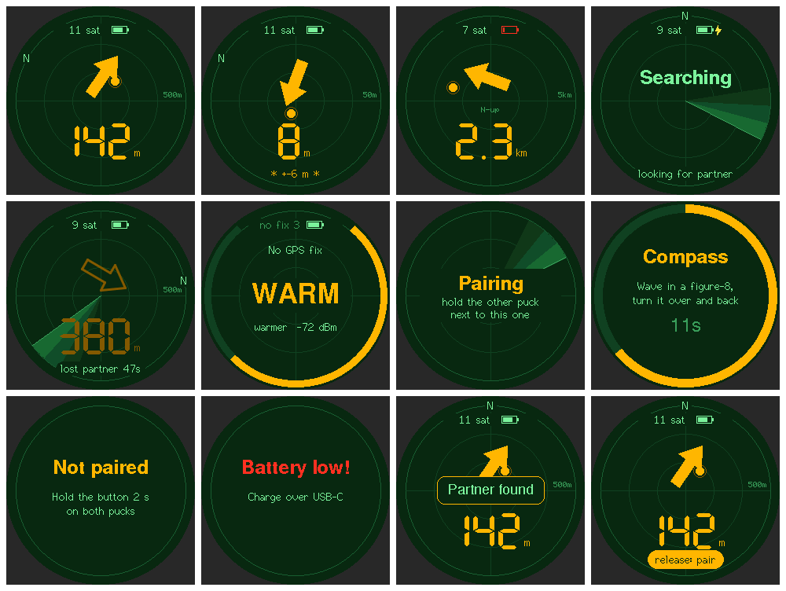

# Finder puck firmware

Firmware for the finder puck board described in the [top-level README](../README.md). Two paired pucks send each other their GPS
position over LoRa every ~1.5 s. Each one shows a **big arrow and the distance** to the other on a round
1.28″ radar screen (GC9A01, 240×240).



- **Arrow:** turned by a tilt-compensated compass (LIS2MDL + LIS3DH), so it works with the puck held at an angle.
  A hollow arrow points to where the partner was last seen.
- **Vibration:** pulses from once every 4 s at 300 m down to about 3 per second within 5 m.
- **Beacon:** the four LEDs strobe short-short-long in the pair's colour when either user presses the button
  (60 s, on both pucks) or the pucks are within about 10 m.
- **No GPS:** when either puck has no fix, the screen shows HOT / WARM / COOL / COLD from the LoRa signal
  strength, with "warmer" or "colder" as it changes. The vibration and beacon also follow the signal strength.

> **Not tested on hardware.** The board hasn't been built yet. This firmware compiles, but none of it has run
> on a real puck. See [Untested](#untested) below.

## Build and flash

You need [PlatformIO](https://platformio.org/). Build both environments:

```bash
cd firmware && pio run
```

Plug a puck into USB-C and flash it:

```bash
pio run -e puck_a -t upload
```

Use `-e puck_b` for the second puck. `puck_a` and `puck_b` are the same firmware; the only difference is the
letter on the start-up screen. Each puck creates its own random ID on first boot and keeps it, its pairing and
its compass calibration in flash (NVS), so reflashing doesn't lose them.

If a fresh board doesn't show up as a serial port, hold the button (IO0) while plugging in USB. This puts the
ESP32-S3 into download mode.

**Power switch:** the slide switch sits at about 7 o'clock on the rim. Slide the knob *away from the button*
(towards 9 o'clock) to turn the puck on; the 1.2 mm dimple in the plate beside the slot marks that ON end. In
that position the switch's terminals 1 and 2 are closed and pull the P-FET's gate (`PWR_G`) to ground. The
cell stays live whatever the switch does: it only steers the FET, the charger is before the switch.

**Build-time pairing (optional, for the bench):** set `PUCK_SECRET` when building both pucks, and they start
already paired:

```bash
PUCK_SECRET="some long random phrase" pio run -e puck_a -t upload
```

Anyone with the same phrase can read and fake that pair's positions. For real use, pair with the button
(below), which replaces the build-time pairing.

## Using it

| Button | Action |
|---|---|
| Press | Beacon on/off for 60 s. Both pucks strobe, so your friend can spot you. |
| Double press | Vibration on/off (remembered) |
| Hold 2 s, release | Pairing mode (hold again to cancel) |
| Hold 5 s, release | Compass calibration |

While you hold the button, the screen shows what releasing it will do, and the motor ticks at 2 s and 5 s.

**Screen:** a radar face with 12 o'clock towards the GPS / sky-window side of the puck.
- **Arrow and blip:** the orange arrow points at the partner, and the orange blip sits at their range on the
  rings.
- **Ring scale:** picks 50 m, 500 m or 5 km to fit the distance. The current scale is printed at 3 o'clock.
- **North:** the `N` marks north. Without a working compass the arrow is drawn north-up, marked `N-up`.
- **Searching:** a sweep goes round while looking for the partner. A hollow arrow points to where they were
  last seen.
- **Top row:** satellites and battery. `GPS?` means no data from the GPS module, and `no fix 3` means 3
  satellites but no fix yet. A lightning bolt means charging. A blinking red battery means it's below 3.5 V.
  Below 3.35 V the screen flashes "Battery low!" and the beacon LEDs stay off.
- **Partner beacon:** `* … *` at the bottom means your partner has their beacon on.

**Pocket mode:** the backlight goes off and the panel sleeps when the puck is face-down for 1.5 s or hasn't
moved for 60 s. Picking it up or pressing the button turns it back on. The radio, GPS, vibration and beacon
keep running.

## Pairing

1. Hold the button for 2 s on **both** pucks and release. Each shows "Pairing".
2. Hold them next to each other. Pairing only accepts a puck with a strong signal (above −75 dBm), which in
   practice means within a few metres. This keeps you from pairing with someone else's puck across the room.
3. Each puck sends its ID and 16 random bytes, and replies with the ID it heard. Once each has heard the other,
   both derive the same key from the two IDs and halves. They show "Paired!" with a long buzz.

If nothing is found within 30 s, it shows "Nobody found" and keeps the old pairing. If one puck says "Paired!"
and the other "Nobody found", pair both again. Serial `f` forgets the pairing.

The pair's beacon colour (one of six) comes from the key, so both pucks in a pair match and different pairs
usually differ.

## Compass calibration

Do this once per puck in its case, away from metal, laptops and speakers. Repeat it if the arrow is clearly
off, or after changing the battery or case.

1. Hold the button for 5 s and release (or send `c` over serial).
2. Wave the puck in a big figure-eight for 15–45 s, turning it over and back so every side faces down at some
   point. The ring round the screen fills as each axis covers enough range.
3. "Compass OK" means the offsets are saved. "Cal failed" means it didn't swing far enough; try again with
   bigger movements.

**Declination:** GPS bearings are relative to true north, and the compass gives magnetic north. Set
`MAG_DECLINATION_DEG` in [src/config.h](src/config.h) for your area. For example, it's about +11° in
San Francisco and −13° in New York. If you leave it at 0, the arrow is off by that much.

## Serial console

Connect over USB at 115200 baud (`pio device monitor`).

| Key | Action |
|---|---|
| `i` | Status: ID, pairing, GPS, partner RSSI, heading, battery, charging, screen on/off |
| `r` | Toggle a 5 Hz stream of raw accelerometer and magnetometer readings plus heading |
| `c` | Compass calibration |
| `p` | Pairing |
| `f` | Forget pairing |

## Radio and packets

915 MHz LoRa, SF9, 125 kHz, CR 4/7, 17 dBm. Each position packet is 30 bytes, about 200 ms on air, sent every
1.2–1.8 s (random spacing, so the pucks don't keep transmitting over each other). The packet carries:

- Pair ID and sender ID, sent in the clear
- A sequence number that never repeats
- Latitude, longitude, fix, satellites, HDOP, battery % and beacon flag. This part is encrypted with
  AES-128-CTR.
- A 4-byte HMAC-SHA256 tag

Pucks drop packets from other pairs, packets with a bad tag, and replayed packets.

Settings for range, timing, haptics and battery thresholds are in [src/config.h](src/config.h). Check your local
radio rules before changing frequency, power or send rate.

## Pins and display

All pins are in [src/config.h](src/config.h) and match `PARTS` in `tools/generate_puck.py`.

| Function | Pins |
|---|---|
| LoRa SX1276 (SPI2) | NSS IO10, MOSI IO11, SCK IO12, MISO IO13, RST IO14, DIO0 IO4, DIO1 IO5 |
| GPS UART | IO17 to the GPS, IO18 from the GPS |
| I2C: LIS3DH 0x18, LIS2MDL 0x1E | SDA IO8, SCL IO9; LIS3DH INT1 on IO2 |
| GC9A01 LCD (SPI3, write-only) | SCK IO40, MOSI IO41, CS IO42, DC IO21, RST IO47, backlight PWM IO48 |
| LEDs, motor, button | WS2812B data IO38 (220 Ω series), motor IO7 (see below), button IO0 |
| Sensing | Battery IO1 (VSYS/2), charger STAT IO6 (100k/150k divider), USB present IO15 (100k/150k divider) |
| Boot logs | UART0 (TX IO43, RX IO44) on test pads TP1/TP2 |

**Motor on IO7:** `PIN_MOTOR` drives the gate of the AO3400A (Q1) that switches the coin motor; high is on, and
`setup()` drives it low before anything else. It used to be IO39, but IO39 is pulled high during reset and would
have run the motor for a moment at every boot, so the board moved it to IO7, which has no reset pull-up.
Keep it off IO39 and the strapping pins (IO0, IO3, IO45, IO46).

The display uses [LovyanGFX](https://github.com/lovyan03/LovyanGFX) on its own SPI host. Each frame is drawn
into a full 240×240 16-bit buffer (115 kB of internal RAM; the N8 module has no PSRAM) and pushed with DMA,
8 times a second. Display settings in `config.h`:

- **`LCD_ROTATION`** (0–3) is the one constant for which way up the picture is. It sets the GC9A01 MADCTL.
  12 o'clock must be the GPS / sky-window side, with the panel's FPC leaving at 6 o'clock. If the picture comes
  out turned, change only this.
- **`LCD_SPI_HZ`** is 40 MHz. 80 MHz may work through the GPIO matrix; try it once a board runs. A
  `static_assert` only accepts 80, 40 or 20 MHz. The other dividers of 80 MHz, 26.67 and 13.33 MHz, have
  harmonics on GPS L1.
- **`LCD_BRIGHTNESS`** is 60/255 by default. The backlight is dark until the firmware drives IO48.

**Screen preview:** [tools/preview_ui/build.sh](tools/preview_ui/build.sh) renders every screen to
`docs/ui-preview.png` on a Mac or Linux PC, using the same drawing code. It needs SDL2 and a prior `pio run`.

## Power

- The CPU runs at 80 MHz.
- The backlight is dim by default, and pocket mode turns it off and puts the panel to sleep.
- The beacon LEDs are off unless the beacon is on.
- The GPS and radio receiver run all the time, because each puck has to be listening when its partner sends.

Rough budget (estimates, not measured):

| Part | Current |
|---|---|
| ESP32-S3 at 80 MHz, no sleep | ~25 mA |
| SAM-M10Q tracking | ~12 mA |
| SX1276 receiving | ~11 mA |
| SX1276 transmitting at 17 dBm (~13% of the time) | ~12 mA average |
| Backlight at 60/255, while on | ~6 mA |

That's about 60–65 mA, or roughly 14–15 h on 950 mAh, which covers a night. If it comes up short, these help
most:
- SF8 instead of SF9, which halves the transmit time.
- Light sleep between loop passes.
- The u-blox power-save mode.

## Untested

None of this has run on hardware. Check these on the first boards:

- **Sensor axes:** `ACCEL_AXIS/SIGN` and `MAG_AXIS/SIGN` in `config.h` are a guess (identity). Use the `r`
  stream with the puck flat and the screen up:
  - Acceleration should read about +1 g on Z.
  - Tilt the top edge of the screen up: Y goes positive and Z falls.
  - Tilt the right edge up: X goes positive.
  - For the magnetometer, turn the puck slowly through a full circle flat on a table. X and Y should trace a
    circle, with Y largest when the top of the screen points north. Swap or negate axes until the heading
    reads 0 facing north and 90 facing east.
  - Then recalibrate.
- **Display:**
  - `LCD_ROTATION` is unverified. It assumes the panel's native top is opposite the FPC.
  - The `invert = true` and RGB order settings are typical for GC9A01 modules. If colours come out negative or
    red and blue are swapped, flip them in `ui.cpp`.
  - The UI has only been checked as rendered images (`docs/ui-preview.png`), not on a panel.
  - The 115 kB frame buffer is allocated at boot. If it ever fails, the firmware falls back to 8-bit colour.
- **Pocket mode thresholds** (face-down at −0.6 g on Z, 0.06 g counts as movement, 60 s still) depend on the
  accelerometer axes being right; see above.
- **Charge sense (IO6, IO15):** STAT reaches IO6 through R20 (100k) with R21 (150k) to ground, so IO6 is low
  while charging or without USB and about 3 V once the cell is full. IO15 sees VBUS through the same 100k/150k
  pair, so the firmware reads both as plain digital inputs: charging = IO15 high and IO6 low; full = both high;
  unplugged = IO15 low. It needs 2 readings in a row, 2 s apart, to change state.
  - **Check on a board:** with USB in and the cell full, IO6 and IO15 should both read about 3.0 V; while
    charging IO6 should be near 0 V.
- **Battery reading:** IO1 reads VSYS through a 100k/100k divider. The ESP32-S3 ADC can be off by tens of mV,
  so check the reading against a meter. The level reads high while charging.
- **GPS:** the SAM-M10Q is used at its factory defaults (9600 baud NMEA, 1 Hz). Nothing sends UBX
  configuration, so no power-save mode or GNSS selection is set. The first fix needs open sky and can take a
  minute or more.
- **Radio range and RSSI thresholds** (HOT/WARM/COOL/COLD, beacon at −55 dBm) are guesses. Tune them with real
  antennas and bodies in the way.
- **Pairing handshake:** the edge case where only one side completes is handled by pairing again, not
  automatically.
- **Random numbers for pairing:** these mix `esp_random()` with SX1276 wideband RSSI noise. Wi-Fi/BT are off,
  so `esp_random()` alone wouldn't be a strong source.
- **USB serial at 80 MHz:** debug output goes over native USB CDC, and RadioLib warns this "might stop on first
  sleep". The firmware doesn't sleep, so this shouldn't matter.
- **LIS3DH INT1 (IO2)** isn't used yet. With light sleep added, it could wake the puck on motion.
- **Regulations:** 17 dBm with about 15% duty cycle on one fixed channel. In the US, FCC Part 15.247 requires
  frequency hopping or digital modulation rules that this single-channel setup doesn't claim to meet. It's
  fine for testing, but check before a product.
